# Tabernacle of Praise — Brand Identity

A GitHub-based creative workspace for developing the distinctive visual identity of **Tabernacle of Praise**, a parish of the Redeemed Christian Church of God (RCCG) in Istanbul, Türkiye.

## Working with Codex

Open this repository as your Codex workspace (cloud or local). Codex reads `AGENTS.md` as project guidance and discovers the repository skill at:

`.agents/skills/rccg-top-identity/SKILL.md`

In a Codex conversation, explicitly request `$rccg-top-identity` and, if available, `$logo-design` for logo construction and validation.

**The logo-design skill must be installed in the Codex environment actually running this repository.** Installing it elsewhere does not guarantee it will be present in a new cloud workspace.

## Project status

The project is in **exploration**, not final-brand production. The standalone wordmark **Tabernacle of Praise** is confirmed. The official RCCG emblem stays separate, used alongside the local logo in authorized lockups. The exact logo, typefaces, colors, and possible harp symbolism are **not yet approved**.

Read [the brand brief](.agents/skills/rccg-top-identity/references/brand-brief.md) before generating designs. Don't copy reference logos, use invented service details, or publish without approval.

## Shared Rhythm motion film 16 — latest development

**DRAFT — NOT FOR PUBLICATION.** A new fourteen-second film develops gathering, a shared rise and folded architecture into the Shared Rhythm identity. The closing hold uses the exact larger RCCG pairing and full two-line name below the parish symbol.

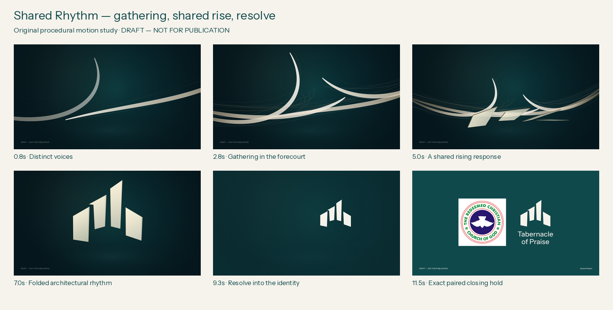

- **[Watch with original sound study](brand/explorations/cinematic-praise-16/exports/shared-rhythm-cinematic-1080p-SOUND-DRAFT.mp4)**
- **[Watch without sound](brand/explorations/cinematic-praise-16/exports/shared-rhythm-cinematic-1080p-SILENT-DRAFT.mp4)**
- **[Download the film and editable sources](brand/explorations/cinematic-praise-16/exports/SHARED-RHYTHM-CINEMATIC-DRAFT.zip)**
- [Browser preview, storyboard, exact closing artwork and notes](brand/explorations/cinematic-praise-16/README.md)

The motion is built procedurally from the parish geometry. No private uploaded footage is included, and the RCCG emblem stays intact. The optional original synthesized sound is a study, with a silent alternative. Shared Rhythm remains an exploration; Open Praise continues as a separate logo option. Final identity, sound and publication approval remain open.

## Larger RCCG emblem 15 — latest static layout

**DRAFT — NOT FOR PUBLICATION.** The separate RCCG seal now nearly matches the height of the complete parish logo, including the name below. Both identities have a more comparable presence. The parish artwork and lettering are preserved.

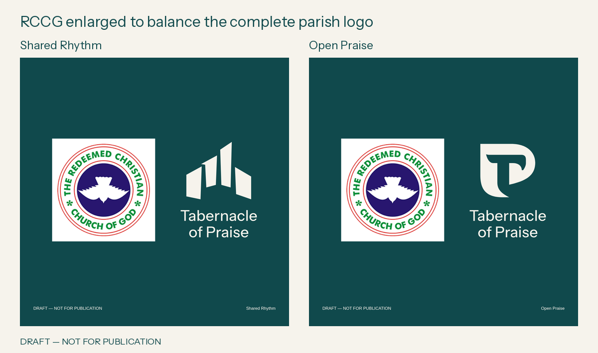

- **[Shared Rhythm — updated PNG](brand/explorations/balanced-emblem-15/exports/shared-rhythm-RCCG-larger-square-DRAFT.png)**
- **[Open Praise — updated PNG](brand/explorations/balanced-emblem-15/exports/open-praise-RCCG-larger-square-DRAFT.png)**
- [Editable SVGs, widescreen PNGs and size notes](brand/explorations/balanced-emblem-15/README.md)

This update covers the static PNG/SVG layouts. The preceding motion graphics below retain their earlier proportions. The original reference PNG stays embedded unchanged; enlarging it adds no source detail or production approval.

## RCCG paired motion graphics 14 — preceding development

**DRAFT — NOT FOR PUBLICATION.** Both parish options now have actual motion graphics with the separate RCCG emblem included. The complete name stays below the symbol. Shared Rhythm expresses a **rising response to praise**; the RCCG emblem and name stay stationary.

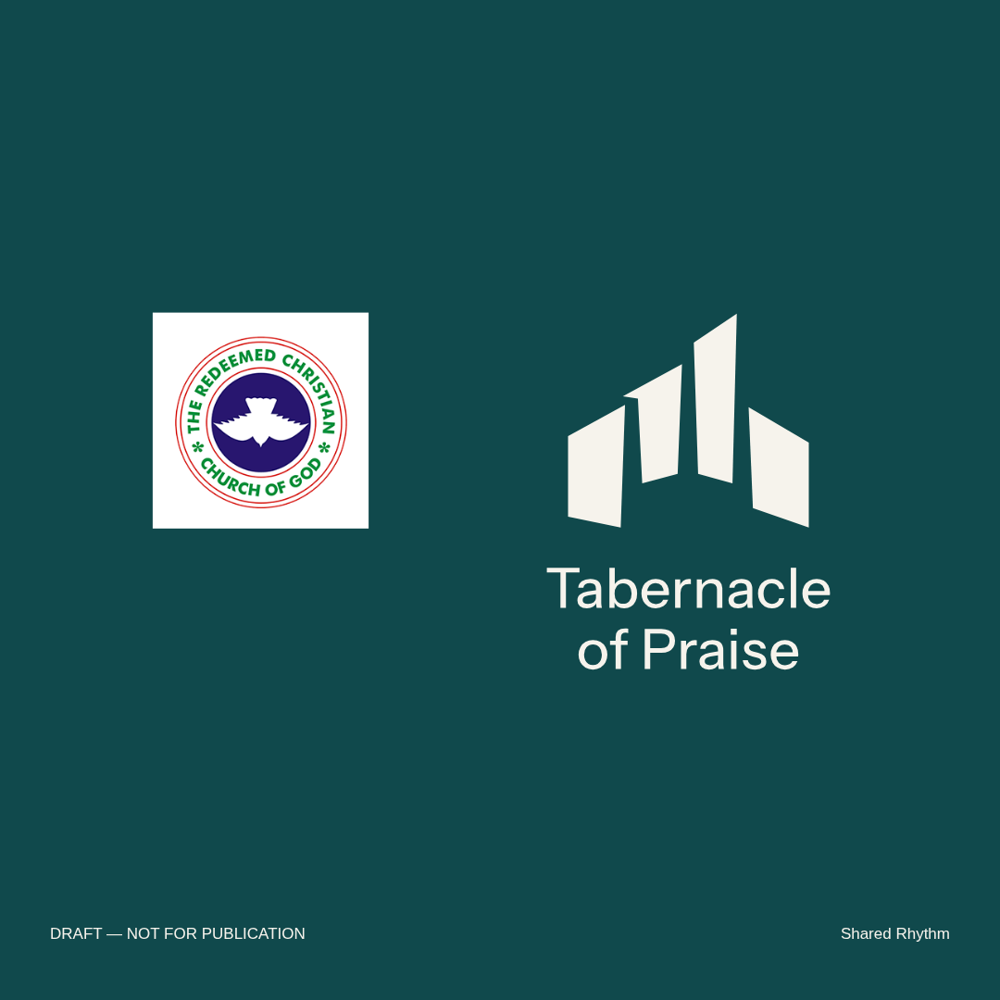

- **[Watch Shared Rhythm — square MP4](brand/explorations/rccg-motion-14/exports/shared-rhythm-RCCG-motion-square-DRAFT.mp4)**
- **[Watch Open Praise — square MP4](brand/explorations/rccg-motion-14/exports/open-praise-RCCG-motion-square-DRAFT.mp4)**
- **[Download both motion graphics and sources](brand/explorations/rccg-motion-14/exports/RCCG-TOP-MOTION-GRAPHICS-DRAFT.zip)**
- [Widescreen videos, browser player, stills and motion notes](brand/explorations/rccg-motion-14/README.md)

Ten-second silent drafts in 1920×1080 and 1080×1080, with a four-second final hold. The full-color RCCG reference stays unchanged on its own white panel. These are controlled vector motion graphics; no Google upload or generation has been performed. Final identity and publication approval remain open.

## Name-below and animation handoff 13 — preceding development

**DRAFT — NOT FOR PUBLICATION.** Both parish options now use the full name below the symbol, including their separate RCCG pairings. Shared Rhythm's motion expresses a **rising response to praise**, with four planes lifting in sequence and the name remaining still below.

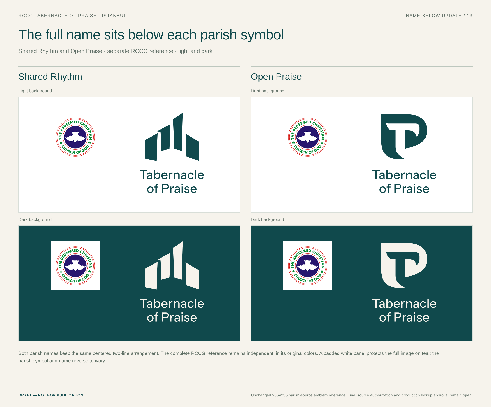

- **[Download updated logos, Google prompts and motion previews](brand/explorations/stacked-motion-13/exports/UPDATED-LOGOS-AND-GOOGLE-ANIMATION-DRAFT.zip)**
- **[Watch the Shared Rhythm motion study](brand/explorations/stacked-motion-13/animation/shared-rhythm-rising-response-1080-DRAFT.mp4)**
- [Google prompt to copy](brand/explorations/stacked-motion-13/exports/shared-rhythm-google-prompt.txt)
- [Clean landscape PNG for Google](brand/explorations/stacked-motion-13/animation-inputs/shared-rhythm/landscape/full-logo-end-DRAFT.png)
- [Updated static pairings, both upload images and instructions](brand/explorations/stacked-motion-13/README.md)

The animation studies are controlled vector previews; no Google upload or generation has been performed. The RCCG reference remains separate, unchanged and excluded from generative animation inputs. Final brand and motion approval remain open; AGENTS.md and the identity skill are unchanged.

## RCCG pairing 12 — preceding draft

**DRAFT — NOT FOR PUBLICATION.** Both teal parish options now have separate light/dark pairing previews with an existing RCCG emblem reference. The emblem remains full color and unaltered on its own white field/panel.

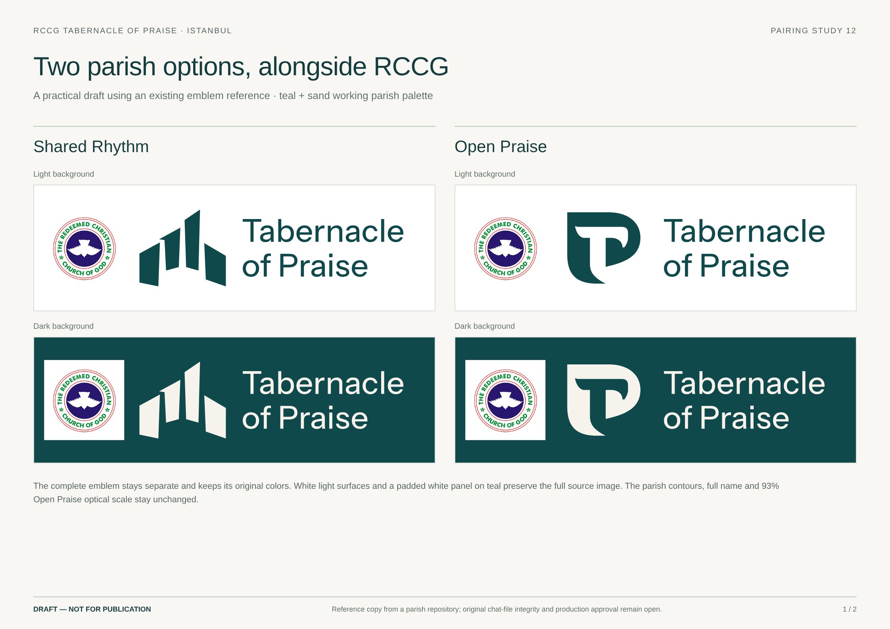

- **[Open the paired preview](brand/explorations/rccg-pairing-12/exports/paired-comparison.png)**
- **[Download the PNG/SVG/PDF ZIP](brand/explorations/rccg-pairing-12/exports/RCCG-and-Tabernacle-of-Praise-DRAFT.zip)**
- [Download the existing emblem PNG](brand/assets/rccg-emblem/references/rccg-wayforward-reference.png)
- [Asset source and integrity record](brand/assets/rccg-emblem/references/README.md)

The PNG is an unchanged 236×236 reference from a public RCCG parish website's source files. It is a separate copy with recorded provenance, not the previously recorded 1200×1200 user-original upload. Final master quality and publication approval remain open. AGENTS.md and the identity skill are unchanged.

## Teal refinement 11 — preceding development

**DRAFT — NOT FOR PUBLICATION.** Teal + sand is the selected working palette for both Shared Rhythm and Open Praise. This pass refines the monogram counter, polishes full-name spacing, adds a single-line arrangement and prepares an actual-size vector print proof. Final branding approval remains open.

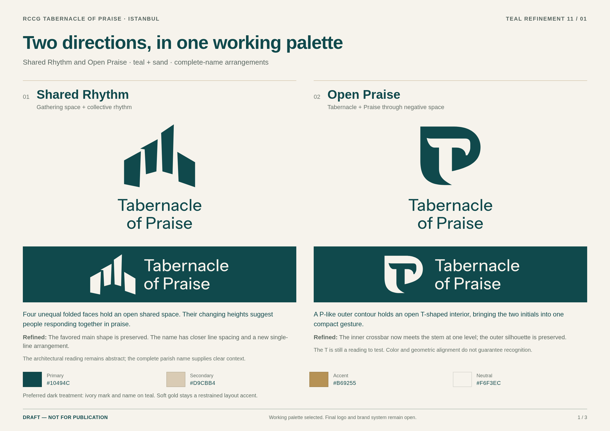

- **[Open the refined comparison PNG](brand/explorations/teal-refinement-11/exports/two-options-teal.png)**
- **[Open the three-page review PDF](brand/explorations/teal-refinement-11/exports/two-option-review-11.pdf)**
- **[Download the A4 vector print proof](brand/explorations/teal-refinement-11/proofs/a4-print-proof.pdf)** — print at 100% / Actual size and check the 50 mm ruler.
- [What changed, editable SVGs, screen proof and outstanding RCCG pairing](brand/explorations/teal-refinement-11/README.md)

Shared Rhythm's favored primary shape is intact. The actual RCCG emblem pairing awaits the original PNG, and physical print results remain unverified. Both directions stay available for later team feedback; AGENTS.md and the identity skill are unchanged.

## Color development 10 — preceding exploration

**DRAFT — NOT FOR PUBLICATION.** Five palette families now compare Shared Rhythm and Open Praise on light and dark backgrounds, with the same geometry and lettering. Teal/sand and navy/gold are provisional shortlist recommendations, not approved colors.

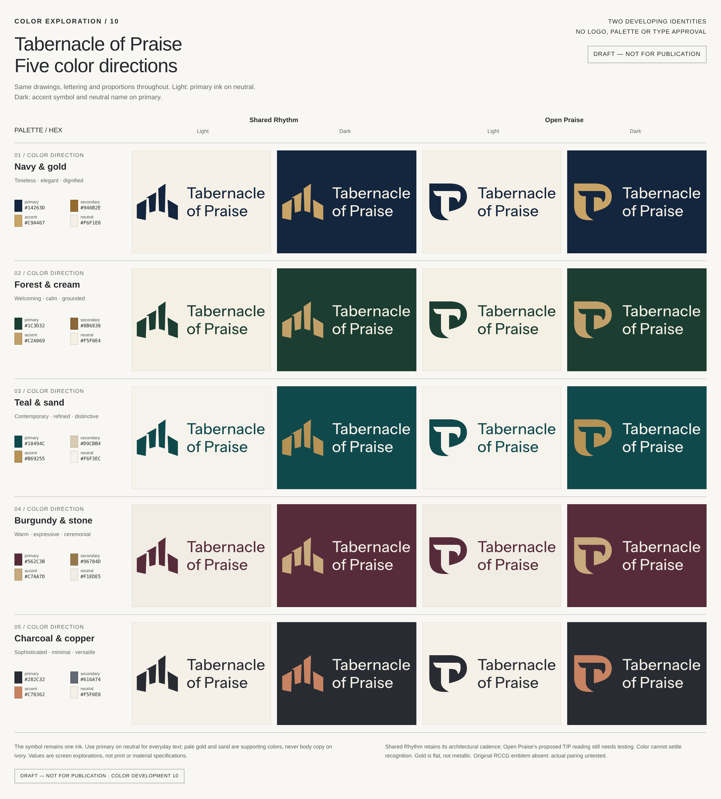

- **[Open the larger teal/navy shortlist](brand/explorations/color-development-10/exports/color-shortlist.png)**
- **[Open the color review PDF](brand/explorations/color-development-10/exports/color-review-10.pdf)**
- [Interactive explorer — download raw HTML, then open in a browser](brand/explorations/color-development-10/exports/color-explorer.html)
- [Color roles, exact HEX values, applications and reusable SVG/source](brand/explorations/color-development-10/README.md)

The study includes monochrome controls and small-size contrast checks. Team feedback remains deferred. No branding decisions are finalized, and AGENTS.md and the identity skill remain unchanged.

## Identity development 09 — preceding development

**DRAFT — NOT FOR PUBLICATION.** Both Shared Rhythm and Open Praise continue in development; team feedback comes later. This iteration preserves the favored Shared Rhythm primary, refines Open Praise's counter, compares three lettering approaches, improves name spacing and tests both on signage, correspondence and social layouts.

- **[Open the comparison PNG](brand/explorations/identity-development-09/exports/two-directions-development.png)**
- **[Open the development PDF](brand/explorations/identity-development-09/exports/development-review-09.pdf)**
- [Three lettering approaches](brand/explorations/identity-development-09/type-study/typographic-comparison.png)
- [Both directions in the same four applications](brand/explorations/identity-development-09/applications/applications-comparison.png)
- [What changed, editable SVGs and sources](brand/explorations/identity-development-09/README.md)

The working title-case lettering, monochrome layouts and tiny-use cuts are provisional. No logo, color palette or typography is finalized. AGENTS.md and the identity skill remain unchanged.

## Team comparison 08 — preceding development

**DRAFT — NOT FOR PUBLICATION.** Shared Rhythm is the user's preferred direction for development. Open Praise is a distinct new letter-based proposal for comparison; neither is a final identity approval.

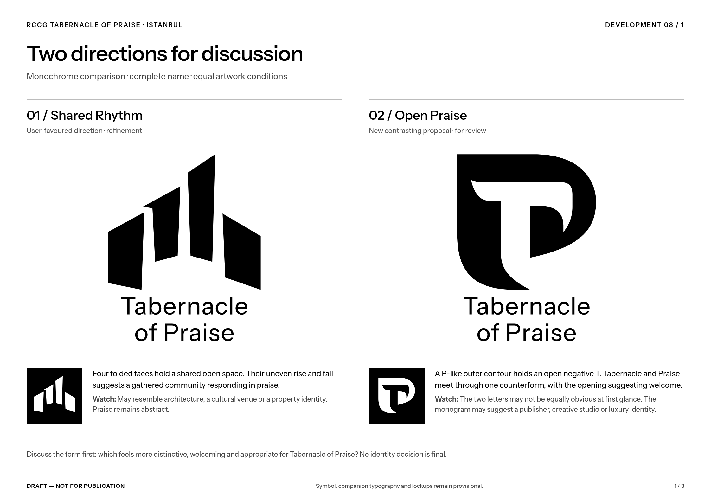

- **[Open the two-direction comparison](brand/explorations/team-pair-08/exports/two-directions.png)**
- **[Open the three-page team PDF](brand/explorations/team-pair-08/exports/team-review-08.pdf)**
- [Meanings, limitations, editable SVGs and sources](brand/explorations/team-pair-08/README.md)

Both options have complete-name horizontal/stacked lockups, black/reverse views, and inspected small-size proofs. The reference logos informed visual principles; their artwork was not copied. Typography remains provisional, and AGENTS.md and the RCCG identity skill are unchanged.

## Praise integration 07 — preceding visual test

**DRAFT — NOT FOR PUBLICATION.** [See the before/after comparison](brand/explorations/praise-study-07/exports/praise-comparison.png), [open the PDF](brand/explorations/praise-study-07/exports/praise-comparison.pdf), or [read the short assessment](brand/explorations/praise-study-07/README.md). Sketches 1, 4 and 5 test worship rhythm or musical detail within their forms, with **Tabernacle of Praise** beneath each. The string-like centre in sketch 5 communicates music most clearly; the other tests remain more ambiguous.

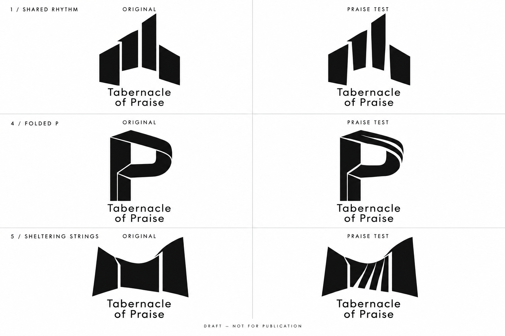

## Sketch reset 06 — rough drawings

**DRAFT — NOT FOR PUBLICATION. Raw exploration includes rejected ideas; no shortlist or identity is approved.**

The chat image previews did not load for the user. Open the saved files directly: [Cadenced Wall roughs A–D](brand/explorations/sketch-reset-06/exports/01-cadenced-roughs.png), [new construction roughs 1–6](brand/explorations/sketch-reset-06/exports/02-new-construction-roughs.png), [lettering roughs A–F](brand/explorations/sketch-reset-06/exports/03-lettering-roughs.png), or [all three boards as a PDF](brand/explorations/sketch-reset-06/exports/sketch-boards-06.pdf). [Working notes and preserved sources](brand/explorations/sketch-reset-06/README.md).

## Creative review 05 — previous exploration

**DRAFT — NOT FOR PUBLICATION. Five developed monochrome directions; no logo, palette or typography is approved.**

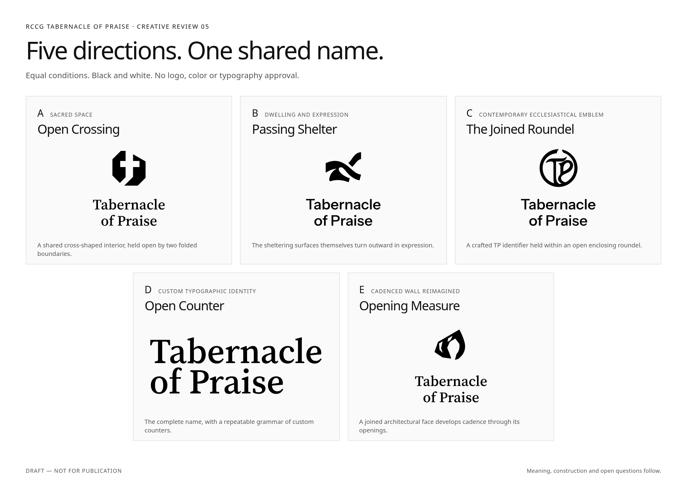

- **[Interactive creative review — download raw HTML, then open in a browser](brand/explorations/creative-review-05/exports/tabernacle-creative-review-05.html)**
- [Six-page artwork and process PDF](brand/explorations/creative-review-05/exports/tabernacle-creative-review-05.pdf)
- [Meanings, candid assessment, editable sources and file guide](brand/explorations/creative-review-05/README.md)
- [Complete editable review ZIP](brand/explorations/creative-review-05/exports/creative-review-05-editable.zip)

Open Crossing, Passing Shelter, The Joined Roundel, Open Counter and Opening Measure compare sacred space, expressive shelter, a crafted TP emblem, custom full-name lettering and a substantial rethinking of Cadenced Wall. The review includes 20 initial premises, construction breakdowns, black/reverse and small-size tests, complete wordmarks and limited identity applications. No weekly flyer templates or final standards are created. AGENTS.md and the RCCG identity skill remain unchanged.

## Strategic study 04 — historical exploration

**DRAFT — NOT FOR PUBLICATION. Research first; no existing concept is approved or a mandatory finalist.**

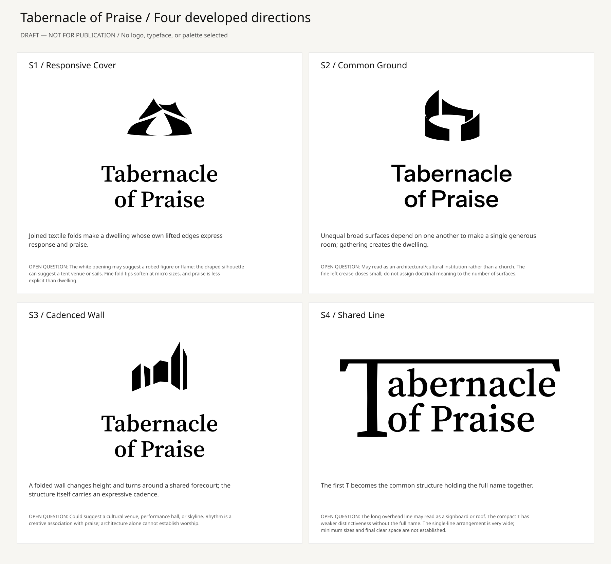

- **[Read the research-based identity strategy](brand/explorations/strategic-study-04/research/identity-strategy.md)**
- **[Open the browser review — download raw HTML, then open in a browser](brand/explorations/strategic-study-04/exports/tabernacle-strategic-explorer.html)**
- [See all 12 investigated ideas across six territories](brand/explorations/strategic-study-04/exports/initial-explorations.png)
- [View the ten-page research/concept/application PDF](brand/explorations/strategic-study-04/exports/strategic-review.pdf)
- [Study notes, editable SVGs, research evidence, and font licenses](brand/explorations/strategic-study-04/README.md)
- [Complete editable study ZIP](brand/explorations/strategic-study-04/exports/strategic-study-04-editable.zip)

The new review develops Responsive Cover, Common Ground, Cadenced Wall, and Shared Line in monochrome, with full names, construction explanations, real-size and reversed tests, and neutral identity applications. The earlier B/C/D and palette studies below remain historical explorations. No weekly flyer generator has been built. AGENTS.md and the RCCG identity skill remain unchanged.

## Color study 02 — historical exploration

**DRAFT — NOT FOR PUBLICATION. B, C, and the additional original D concept; five palette directions; no final identity decisions.**

[See what the logos mean, component by component](brand/concepts/exploration-03/README.md).

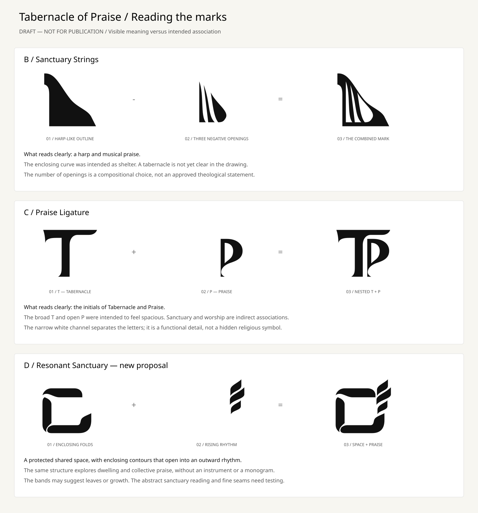

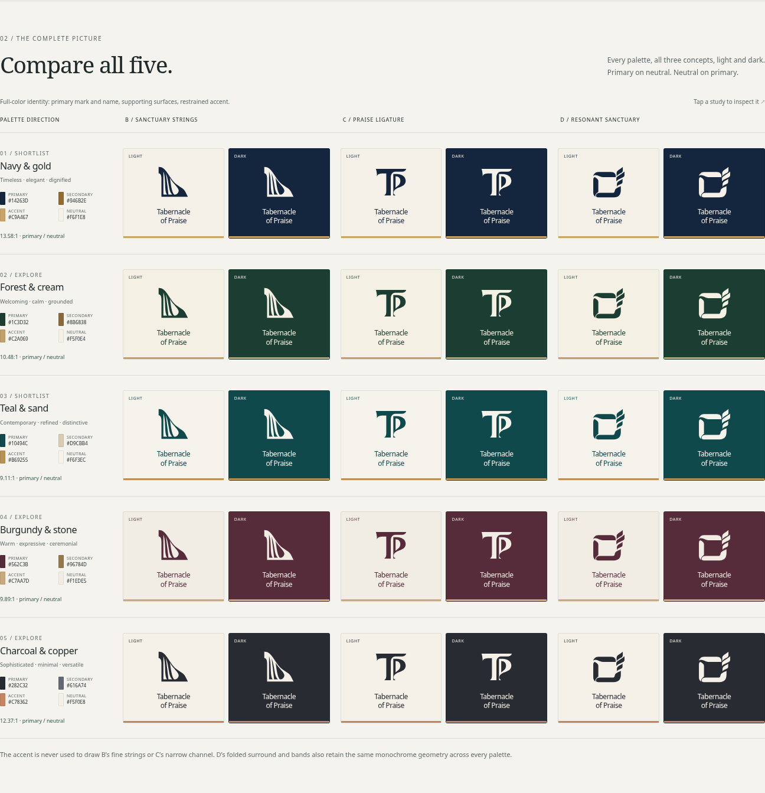

- **[Interactive explorer — download this single HTML file and open it in a browser](brand/explorations/color-study-02/exports/tabernacle-color-explorer.html)**. On the GitHub file page, use **Download raw file**; GitHub's code view does not run the app.
- [View the ten-page color/application review PDF](brand/explorations/color-study-02/exports/color-study-review.pdf)
- [Browse the editable study, exact HEX values, applications, and recommendations](brand/explorations/color-study-02/README.md)
- [Download the complete editable study ZIP](brand/explorations/color-study-02/exports/color-study-02-editable.zip)

The explorer includes equal B/C/D comparisons and visual meaning breakdowns, light/dark and monochrome controls, swatches, contrast calculations, actual-size tests, editable colors, saved pairings, SVG downloads, and Sunday flyer/Instagram/avatar/signage studies. AGENTS.md and the church identity skill have not been updated.

## Draft logo exploration 01

**DRAFT — NOT FOR PUBLICATION. These are proposals for review; no mark, typography, or color decisions are approved.**

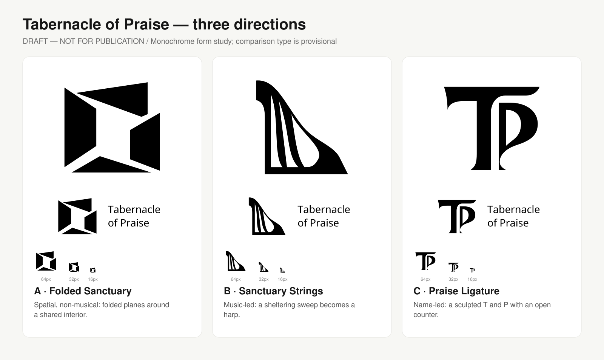

- [View the full-size comparison](brand/concepts/exploration-01/three-directions.png)
- [Open the one-page PDF](brand/concepts/exploration-01/exports/three-directions.pdf)
- [Read the symbolism, construction notes, tradeoffs, and test results](brand/concepts/exploration-01/README.md)
- [View light/dark small-size tests](brand/concepts/exploration-01/small-size-tests.png)
- [Download the draft concept bundle](brand/concepts/exploration-01/exports/draft-concepts.zip)

Editable SVGs, meaningful prior iterations, and geometry sources are retained in the concept folder. The installed [logo-design skill](.agents/skills/logo-design/SKILL.md) is included with its upstream license and library trademark notices. Cloud setup and startup instructions are retained in [tools/cloud](tools/cloud/).

## Suggested future folders

- `brand/concepts/` — new logo explorations, editable SVGs
- `brand/approved/` — approved-only identity assets
- `brand/references/` — inspiration images with original source/rights notes
- `media/templates/` — approved church flyer templates

Never mistake concept assets for approved logos.
