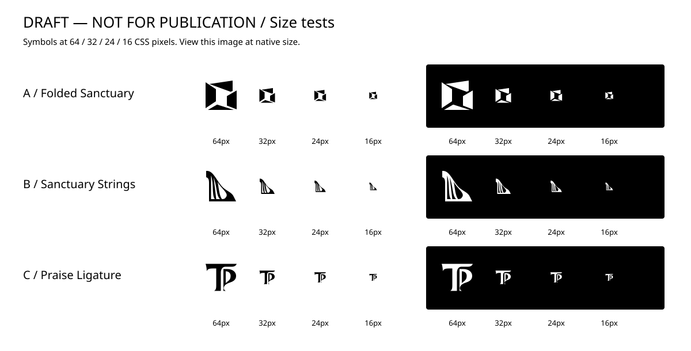

# Tabernacle of Praise — exploration 01

**DRAFT — NOT FOR PUBLICATION. No concept, palette, typeface, or lockup is approved.**

Start with `three-directions.png` for the comparison and `small-size-tests.png` for actual-size light/dark samples. The corresponding SVGs are editable. Current symbol studies are the three `*-v3.svg` files; earlier iterations remain for comparison. `source/` retains the geometry builders.

[Open the comparison image](three-directions.png) · [One-page PDF](exports/three-directions.pdf) · [Draft concept bundle](exports/draft-concepts.zip)

The initial image-generation study is retained at `source/initial-generated-exploration.png` as process history. The vector studies shown here are independently constructed revisions, not an exact vector trace of that image. The PDF is an export of the revised vector comparison.

## Brief and evidence

Read: repository `AGENTS.md`; `rccg-top-identity/SKILL.md` and its church profile, brand brief, and production standards; installed `logo-design/SKILL.md` and its discovery, construction, visual technique, typography, and testing references.

RCCG Tabernacle of Praise is a parish in Istanbul, Türkiye. The confirmed standalone name is **Tabernacle of Praise**. The independent parish identity must be modern, minimal, expressive, warm, and welcoming. Its audience includes church members and visitors, families, students, young adults, and newcomers to Istanbul, without asserting demographic statistics or an official mission statement.

The brief records favorable early architectural exploration, followed by rejected Open Tabernacle, Lifted Canopy, Gathered Arch, doorway, split-arch, and arch/person variations. These sketches use spatial planes, an instrument-led sweep, and lettering, rather than revisiting those front-view formulas. The repository supplies written feedback, but no actual historic concept/inspiration image files; no claim is made to have inspected those absent images.

The RCCG emblem remains separate and unaltered. No authorized emblem asset is supplied, so it has not been drawn or simulated here. Combined official lockups await that asset and later review.

## Three territories

### A — Folded Sanctuary / spatial symbol

**Idea:** Folded fabric defines a shared interior, evoking a tabernacle as a dwelling and a place of gathering.

**Construction:** Four solid, unequal planes frame a generous asymmetric counter. White seams communicate fold and depth in one ink; there is no front-facing arch, figure, cross, or doorway. The diagonal rhythm could later inform letter terminals or supporting layouts.

**Tradeoff:** Strongest broad parish identity and most durable silhouette of the set. It can also suggest an aperture, folded carton, or architectural practice. Sanctuary is an association, not an unmistakable religious pictogram. Further development should make the fold relationship more specific without adding generic church symbols.

### B — Sanctuary Strings / instrument-led symbol

**Idea:** A protective sweep and three rhythmic openings explore the relationship between dwelling and praise.

**Construction:** One continuous asymmetric mass contains the string counterforms; a broad upright, rising curved shoulder, and grounded base carry both structure and rhythm. The instrument is not inserted inside an independent house outline. The second pass increases string spacing and baseline weight.

**Tradeoff:** The harp reading is strong; the sanctuary reading is currently weaker. It may identify a choir or worship ministry more readily than an entire parish. At 16px, individual strings become subordinate to the silhouette. Choosing this route would approve further exploration of musical emphasis, not automatically approve harp inclusion in the identity.

### C — Praise Ligature / name-led symbol

**Idea:** The T of Tabernacle and P of Praise make the name itself the identifier.

**Construction:** A broad T head, sculpted stem, and nested P curve share a closely related contour system. An open vertical channel preserves two letters; the generous P counter supplies breathing room. The actual parish name accompanies the monogram; TOP has not been substituted as the standalone name.

**Tradeoff:** Distinct from the two pictorial routes and potentially strong alongside a separate RCCG emblem. Its sculpted terminals feel more editorial/classical than the other directions; sanctuary symbolism is secondary and should not be overstated. T/P monograms are common territory, so later letterform development must establish more specificity.

## Exploration and selection

The ten initial ideas were resonant shelter, woven sanctuary, praise ligature, sanctuary in plan, gathered pleat, resonant wall, open assembly, worship rhythm, praise counterform, and cantilevered tabernacle. The selected three deliberately use different governing structures: spatial planes, curved instrument, and letterform. Further roof/canopy variations were excluded because of the recorded rejections; radial knots and congregations of dots were avoided because they drift into generic community/technology identities.

Library research used folded-plane, negative-space, rhythm, and letterform studies (`tsuru`, `pagekit`, `amplitude-icon`, `soundcloud`, and `zendesk-icon`) as construction lessons, without tracing their forms. This library is technology-heavy and does not establish distinctiveness among church identities. No trademark clearance is claimed.

## Checks and limits

- Rendered and visually inspected the initial and revised vector comparison sheets.
- SVG audit: no FAIL findings, live text, raster images, gradients, masks, or filters in the current symbol studies. A retains one angle heuristic warning on a deliberately asymmetric fold; its geometry remains exploratory. B and C return no audit issues. Scores are tool heuristics, not approval or evidence of distinctiveness.
- Rendered actual-size 64, 32, 24, and 16px light/dark tests. A retains its spatial silhouette best. B's string detail and C's T/P separation need additional micro-size work if selected; do not call these production-ready favicons.
- Monochrome comparison lockups use the same outlined **Noto Sans Regular** specimen to isolate the symbol differences. This is not a proposed or approved brand typeface, custom wordmark, spacing system, or fixed lockup. Font source: `/usr/share/fonts/truetype/noto/NotoSans-Regular.ttf`; SIL Open Font License 1.1, documented in `/usr/share/doc/fonts-noto-core/copyright`. No font binary is redistributed.
- `diagnostic-tests.html` is a supplementary generated worksheet. It contains generic interface contexts, not actual church communications. Its optional Chromium screenshot attempt failed with `chrome produced no file`; no browser inspection is claimed. The dedicated SVG/PNG size sheet was rendered directly through Inkscape and visually inspected as the primary light/dark evidence.
- Actual signage, authorized two-logo arrangements, printing, and church-category resemblance checks remain for a selected direction; no claim is made that these have been completed.

## Decisions still open before the next phase

Which territory merits refinement; whether music should identify the whole parish; how literal the sanctuary reference should be; custom wordmark style and case; palette; authorized RCCG source asset and eventual lockup proportions. The suggested next exploration is **A**, with **B** as an alternative if the church wants music to be central. This is a recommendation for discussion, not a branding decision.

Review the three routes first. No final logo kit, brand standards, or publication work has begun.
