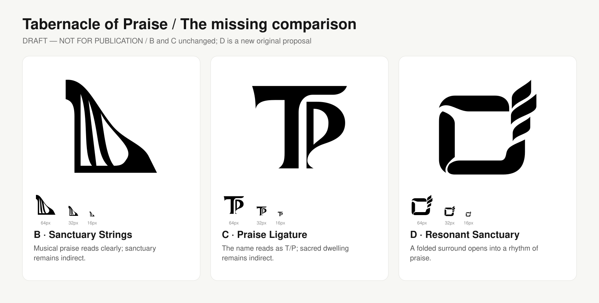

# Reading the marks — B, C, and the additional original concept

**DRAFT — NOT FOR PUBLICATION. No logo, palette, typography, or replacement decision is approved.**

The additional original concept is **D — Resonant Sanctuary**. B and C keep their existing v3 geometry. D is numbered separately so it cannot be confused with the earlier A — Folded Sanctuary.

- [Open the full visual explanation](logo-meaning-breakdown.png) · [editable explanation SVG](logo-meaning-breakdown.svg)
- [Compare B, C, and D in monochrome, including actual-size symbols](third-concept-comparison-v1.png)
- [Explore all five palettes with B/C/D](../../explorations/color-study-02/README.md)
- [Editable D symbol](d-resonant-sanctuary-v1.svg)

## B — Sanctuary Strings

The harp-like outer mass minus three tapered negative openings produces the rhythm of strings. **Musical praise is the clearest reading.** The enclosing curve was intended to suggest shelter, but a tabernacle is not clearly communicated by the drawing yet. Its music emphasis could suggest a choir or worship ministry rather than the whole parish.

The three openings are a compositional choice. They do not make a Trinity claim or establish an official theological meaning. At 16px, the gaps and strings lose independence. Color cannot solve that structural weakness.

## C — Praise Ligature

A custom **T for Tabernacle** and **P for Praise** nest into a name-based identifier. A narrow white channel keeps the two letters separate. Its broad head and spacious counter were intended to suggest room and shelter; worship and sanctuary are indirect associations. There is no hidden cross, dove, or person to explain.

Its broad shape is the current practical benchmark for whole-parish use, but the T/P channel still needs refinement at small sizes. The terminals have an editorial, classical quality that should be judged against the desired modern character.

## D — Resonant Sanctuary: why it deserves comparison

Folded contours define a **shared interior**, then open into a **rising rhythm** at the upper-right. The interior explores dwelling, sanctuary, and gathering. The rhythmic edge explores collective praise. This brings the two halves of the name into one structure without another instrument or initials.

The construction uses six closed, filled paths: three enclosing folds and three rising bands, on the same 256-unit symbol canvas as B and C. Seams are real gaps that reverse with the background. Its near-square silhouette creates a different visual family from B's triangular instrument and C's letterform. It does not reuse a doorway, arch, stick figure, roof/cross, or supplied inspiration silhouette.

The sanctuary is abstract, seen as a surrounding space rather than literal biblical architecture. **The rising bands can read as leaves or growth.** That is a meaningful risk for a church identity, particularly in forest green, and needs your judgment. Fine seams and the smallest band also need 16–32px and physical-material refinement. The number of bands is compositional, with no doctrine implied.

## Recommendation for the next review

Keep **C as the durability benchmark** and **D as the shared-space challenger**. D is worth a refinement comparison because it addresses sanctuary more directly than B/C. It has not proved stronger overall. If sanctuary should lead over music, D could take B's place in the next round; no replacement is approved. B remains available if musical praise should be central.

The two strongest palette directions remain **Deep Teal + Sand + Soft Gold**, then **Navy + Gold + Ivory**. The expanded color explorer applies all five families equally to all three marks, light and dark; teal/navy applications also include all three.

## Editable sources and checks

- `source/build_third_concept.py` rebuilds D's SVG.
- `source/build_meaning_breakdown.py` reads the actual B/C/D paths and rebuilds the explanation SVG.
- `source/initial-generated-ideation.png` retains the generated visual ideation used to develop D. The delivered paths are a separate editable reconstruction, not an embedded raster or a trace of a reference logo. No claim of legal exclusivity or trademark clearance is made.
- D was rendered, visually inspected in monochrome and at comparison sizes, and audited using the installed logo-design skill. Automated SVG audit results are construction diagnostics, not a design approval.
- The expanded explorer verifies D's exact path geometry and inherited translation, alongside unchanged B/C paths. Screen and physical-proof limitations remain documented in the color study.

No official RCCG asset has been supplied. Only a separate labeled reservation appears in the study. `AGENTS.md` and the RCCG identity skill remain unchanged.
