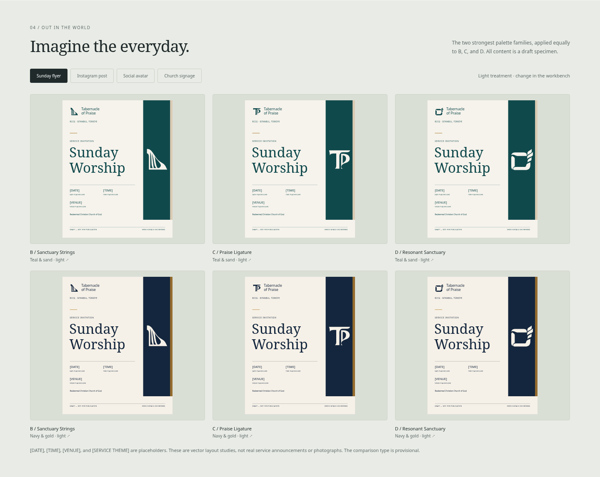

# Tabernacle of Praise — color study 02

**DRAFT — NOT FOR PUBLICATION. No logo, palette, typography, or official lockup is approved.**

An interactive, reusable comparison of **B — Sanctuary Strings**, **C — Praise Ligature**, and the new **D — Resonant Sanctuary** across five color directions. B/C retain their original v3 path geometry. D adds a folded shared-space and rising-rhythm idea; no replacement is approved.

## View the work

- **[Interactive explorer — single offline HTML file](exports/tabernacle-color-explorer.html)**: on GitHub, use **Download raw file** on the file page, save the `.html` file, and open it in a browser. The file contains its scripts, styles, and fonts; no installation or internet connection is required.
- [All-five comparison image](exports/comparison-matrix.png): directly viewable on GitHub.
- [Ten-page review PDF](exports/color-study-review.pdf): matrix, four application types in light/dark, and recommendations.
- [Complete editable study ZIP](exports/color-study-02-editable.zip): source app, fonts/licenses, proposed palette data, editable SVGs, review images, PDF, offline explorer, and the new concept sources.
- [Source app](index.html): classic HTML/CSS/JavaScript with local fonts. Open it locally or serve this directory with any static server. GitHub's source viewer does not execute the app.


## Meaning and construction

[The visual breakdown](../../concepts/exploration-03/logo-meaning-breakdown.png) shows B’s harp-like outline minus its negative openings, C’s T plus P, and D’s enclosing folds plus rising rhythm. B communicates musical praise most clearly; C communicates the name; D tests sanctuary/gathering and praise in one abstract structure. D’s bands may suggest leaves or growth. Intended associations are distinguished from visible meaning. [Read the concept rationale and tradeoffs](../../concepts/exploration-03/README.md).

## What the explorer does

- Switch between five palettes with the same B/C/D sizes, proportions, geometry, typography, and color-role assignments.
- Inspect B, C, and D side by side on light and dark backgrounds; the complete matrix keeps all 30 cases visible.
- Inspect 64/32/24/16 CSS-pixel symbols and use a pure black/white control. Color cannot repair missing strings or a closing monogram channel.
- Read and copy all role HEX values, edit proposed colors locally, and see contrast recalculate immediately. Invalid HEX input is rejected; original proposals can be restored.
- Enlarge each mark and each application, download editable SVGs, save pairings, and export study choices/HEX values as JSON.
- Use the standalone explorer without external requests. Saving that offline page retains current palette edits and saved pairings.

## Proposed palette values

These are exploratory screen values, not approved brand standards. Gold is flat color here, not a metallic finish.

| Direction | Primary | Secondary | Accent | Neutral |
| --- | --- | --- | --- | --- |
| Navy + Gold + Ivory | `#14263D` | `#946B2E` | `#C9A467` | `#F6F1E8` |
| Forest Green + Warm Gold + Cream | `#1C3D32` | `#8B6838` | `#C2A069` | `#F5F0E4` |
| Deep Teal + Sand + Soft Gold | `#10494C` | `#D9CBB4` | `#B69255` | `#F6F3EC` |
| Burgundy + Muted Gold + Light Stone | `#562C3B` | `#96784D` | `#C7AA7D` | `#F1EDE5` |
| Charcoal + Ivory + Copper Accent | `#282C32` | `#616A74` | `#C78362` | `#F5F0E8` |

### Color roles and fairness

Light presentation uses **primary on neutral**. Dark presentation uses **neutral on primary**. The mark and name always use that high-contrast pair. Secondary colors support larger surfaces; accents supply the same restrained keyline/detail. The full-color identity is presented around the same single-ink symbol, without splitting or recoloring its structural parts. No palette gets a different logo, larger mark, extra detail, or more favorable composition.

| Direction | Primary / neutral | Accent / neutral | Use of accent on light |
| --- | ---: | ---: | --- |
| Navy | 13.58:1 | 2.08:1 | Decorative only |
| Forest | 10.48:1 | 2.17:1 | Decorative only |
| Teal | 9.11:1 | 2.62:1 | Decorative only |
| Burgundy | 9.89:1 | 1.90:1 | Decorative only |
| Charcoal | 12.37:1 | 2.70:1 | Decorative only |

Ratios use WCAG sRGB relative luminance. Normal text needs 4.5:1 and large text 3:1. All proposed primary/neutral pairs exceed 9:1. Gold-like accents on light grounds are not suitable for small text or fine logo detail. Navy secondary/neutral is **4.24:1**, and forest secondary/neutral **4.47:1**; neither is rounded into a normal-text pass. Teal sand is a supporting surface, not light-ground text. The interactive readout also exposes secondary/light and accent/dark ratios.

## Applications

Both shortlisted palettes, **teal and navy**, are applied to all three concepts in each of four layouts. The application tab and background toggle keep the conditions consistent.

| Application | Editable canvas | Review image |
| --- | --- | --- |
| Sunday service flyer | 1080 × 1350 | [Six equal comparisons](exports/application-flyer.png) |
| Instagram post | 1080 × 1080 | [Six equal comparisons](exports/application-instagram.png) |
| Social avatar | 512 × 512, circular-crop preview | [Six equal comparisons](exports/application-avatar.png) |
| Simple church signage | 1400 × 840, illustrative vector elevation | [Six equal comparisons](exports/application-signage.png) |

There are **48 editable application SVGs** in [exports/applications](exports/applications/) (2 palettes × 3 concepts × 4 applications × 2 backgrounds), plus **30 proposed-color symbol SVGs** in [exports/marks](exports/marks/).



All event information remains visibly bracketed: `[DATE]`, `[TIME]`, `[VENUE]`, `[SERVICE THEME]`. No timetable, address, Scripture, mission, clergy, or contact details have been invented. Signage is explicitly an illustrative elevation, not the actual church premises. No photographs are fabricated or sourced.

## Recommendations for discussion

1. **Deep Teal + Sand + Soft Gold:** strongest contemporary distinction, with warmth supplied by sand and a measured gold accent. Primary/neutral contrast is 9.11:1. Proof the teal on real paper and sign materials before specifying print color.
2. **Navy + Gold + Ivory:** dignified, elegant, and dependable, with a 13.58:1 core contrast and favorable exploratory history. Its familiar church/luxury associations mean the mark must supply distinctiveness.

Forest is a welcoming runner-up, with stronger nature/heritage associations. Burgundy is expressive and ceremonial, potentially more solemn than the everyday welcome sought here. Charcoal/copper is versatile, but recognition would rely more heavily on shape and typography.

**Concept C is the stronger current whole-parish direction.** Its broad monogram is more robust across signage and social contexts than B's fine string structure. Its editorial/classical terminals and T/P separation still need refinement; this is not logo approval. B remains an expressive musical alternative, particularly if the church wants music central to its identity. At 16px its strings lose independence; color is not a solution.

**D — Resonant Sanctuary is the new shared-space challenger.** Its folded surround and rising rhythm explore dwelling and praise together, addressing a weaker association in B/C. The possible leaf/growth reading and fine seams need testing. Compare D against C in the next refinement round; D could take B’s place if sanctuary should lead over music, but no replacement is approved and D has not proved stronger overall.

### RCCG affiliation and production limits

B, C, and D are shown next to an explicitly labeled, separate neutral-backed reservation for the official RCCG emblem. The authorized artwork has not been supplied; no emblem has been generated, redrawn, recolored, or merged. Actual emblem color competition and authorized combined lockups remain untested.

Screen HEX is not a print proof, Pantone specification, ink recipe, foil decision, or signage-material sample. Physical proofing remains necessary. Color/shape study does not establish trademark clearance or legal exclusivity.

## Editing and reuse

- `data.js`: proposed palettes, role names, assessments, and exact existing B/C path data, new D geometry, and literal meaning notes.
- `styles.css`: responsive explorer interface and local font declarations.
- `app.js`: interaction, contrast calculations, local persistence, previews, color editing, and downloads.
- `applications.js`: editable SVG layouts; same construction for every pairing.
- `assets/`: Noto Sans Regular and Noto Serif Regular, with their SIL Open Font License notice. These are common **comparison specimens**, not an approved typography system. Two tiny, renamed Noto Symbols subsets supply interface arrows/stars/checkmarks offline; their reproducible subset builder is retained in `tools/build_ui_symbols.py`.
- `tools/build_exports.py`: makes the fully inlined offline page, proposed palette JSON, and SVG exports.
- `tools/verify_explorer.py`: substantive Chromium interaction and export verification.
- `tools/capture_review.py`: captures review images and builds the print review from the same layout renderer.
- `tools/package_review.py`: packages the study, new concept sources, and B/C symbol originals with repository-relative paths, without self-including the ZIP.

Individual application SVGs retain editable text and reference the supplied comparison font families (with common fallbacks). Install the included fonts or substitute fonts intentionally if editing those SVGs outside the explorer. Symbol SVGs contain paths and do not need fonts. The standalone explorer embeds fonts and requires no external assets.

Rebuild from the repository environment:

```sh
python3 brand/explorations/color-study-02/tools/build_exports.py
```

For browser verification/captures, first serve this study directory with a loopback-only static server, then run its verification and capture scripts. Their optional first argument is the test server URL. Python Playwright and Chromium are development checks, not runtime dependencies of the delivered app.

## Validation evidence

[The validation report](exports/validation-report.json) records 11 substantive checks: all five palettes and 30 cases; exact B/C path preservation and D source/transform fidelity; independent contrast and equal-size checks; keyboard/dark/mono state; large previews, download and focus return; B/D saved pairings/JSON; failing-contrast and invalid-HEX behavior; all four application types and SVG downloads; 1440/768/390px responsive layouts; zero-external-request offline initialization and saved-page reopening; all 78 mark/application SVG exports parse and retain draft metadata.

Source was tested through an internal HTTP server. The environment's managed browser blocks `file://` navigation, so direct desktop double-click was not tested here; the actual self-contained HTML was executed in memory with no external requests, including its save/reopen behavior. Review images and the PDF were rendered in Chromium and visually inspected. PDF page content is checked against footer boundaries to prevent cropped matrix rows.

`AGENTS.md` and the RCCG identity skill are unchanged. This work proposes, compares, and records feedback; it does not approve or publish a final identity.
