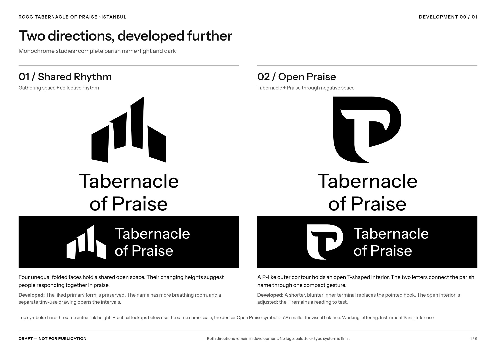

# Shared Rhythm + Open Praise — development 09

**DRAFT — NOT FOR PUBLICATION.** Both directions continue in development. Team feedback is deferred; neither logo, palette, typography nor production specification is approved.



- **[Open the comparison PNG](exports/two-directions-development.png)**
- **[Open the six-page development PDF](exports/development-review-09.pdf)**
- [Three lettering approaches](type-study/typographic-comparison.png)
- [Both directions in the same four applications](applications/applications-comparison.png)

## What changed

**Shared Rhythm:** the favored primary drawing stays intact. Its four unequal folded faces turn around an open gathering space; their changing heights suggest collective praise. A separate small-use drawing opens the intervals at 16–20 px while preserving the little folded shoulder. It is more disconnected when enlarged, so the original remains in ordinary avatars, signage and documents. Four separate raster components support separation, not proof that viewers recognize a tabernacle or praise. The mark can still suggest architecture or a cultural venue.

**Open Praise:** the single outer contour stays recognizable while its interior hook becomes shorter and less beak-like. A slightly wider negative stem supports the proposed T/P relationship. The T remains less obvious than the P; this is a name-based monogram, not a literal worship symbol. A second tiny-use cut tests a more open stem, at some cost to the expressive counter. Publisher, studio and heritage associations remain possible.

**Lettering and spacing:** three approaches were compared: welcoming title case, tracked capitals and a warmer serif. Instrument Sans title case at weight 470 is the working companion for both, with shaped outlines and optical spacing. It is font-based lettering, not a claim of custom-drawn type. The capitals and serif remain editable alternatives. The stacked layouts now leave more space between the mark and the complete name. In practical lockups Open Praise sits 7% smaller than Shared Rhythm at the same name scale to balance its greater ink mass. The main overview also shows symbols at equal actual ink height for an honest control.

**Applications:** both now appear in identical illustrative entrance signage, A4 correspondence, a welcome post and an avatar/profile study. These are monochrome layout studies, not a new palette or an approved template system. The entrance is an imagined proportion diagram, not a photograph of church premises. `[CORRESPONDENCE TEXT]`, `[CONTACT DETAILS]` and `[CHURCH HANDLE]` are placeholders. No schedule, event, mission, address or contact detail is invented.

## Editable artwork

| Direction | Primary symbol | Tiny-use candidate | Horizontal name | Stacked name |
|---|---|---|---|---|
| Shared Rhythm | [SVG](shared-rhythm/primary.svg) | [SVG](shared-rhythm/compact.svg) | [SVG](exports/shared-rhythm-horizontal-DRAFT.svg) | [SVG](exports/shared-rhythm-stacked-DRAFT.svg) |
| Open Praise | [SVG](open-praise/primary.svg) | [SVG](open-praise/compact.svg) | [SVG](exports/open-praise-horizontal-DRAFT.svg) | [SVG](exports/open-praise-stacked-DRAFT.svg) |

Reverse lockups and wordmark-only SVGs sit beside these in `exports/`. [Assembly metadata](exports/development-artwork.json) records all paths, the provisional scale adjustment and the exact working font. Actual symbol geometry and lettering are paths; they need no external font to display.

- [Shared Rhythm construction, preserved iterations and native-size proofs](shared-rhythm/README.md)
- [Open Praise construction, preserved iterations and native-size proofs](open-praise/README.md)
- [Type source files, axes, optical spacing and unmodified font licenses](type-study/README.md)
- [Application sources and placeholders](applications/README.md)
- [Current source brief](source/brief.md)
- [Previous development 08](../team-pair-08/README.md)

## What remains open

Shared Rhythm remains the user's preferred starting point. It is more expressive about space and shared rhythm; Open Praise provides a compact, different alternative based on the name. Both deserve continued evaluation. Tiny 16–20 px versions preserve a silhouette rather than the full symbolic explanation; primary contours are clearer at 24–32 px and above. Native render tests do not establish physical print, vinyl or embroidery minimums.

The supplied RCCG emblem's [metadata](../../assets/rccg-emblem/README.md) is available, but its original PNG is still absent from this checkout. No emblem is recreated or merged into the parish mark, and actual official pairing remains untested. Color, permanent typography, legal originality checks and final branding decisions remain open. AGENTS.md and the identity skill are unchanged.

## Rebuild

From the repository root, use Python with fontTools, Pillow, Inkscape and Playwright/Chromium available:

```sh
python brand/explorations/identity-development-09/shared-rhythm/source/build.py
python brand/explorations/identity-development-09/open-praise/source/build.py
python brand/explorations/identity-development-09/type-study/build.py
python brand/explorations/identity-development-09/tools/build_lockups.py
python brand/explorations/identity-development-09/applications/build.py
python brand/explorations/identity-development-09/tools/build_delivery.py
```

Symbol/type builders preserve meaningful iterations; application/delivery builders read the current assembly metadata. PNG and PDF files are ordinary saved artifacts so the work can be opened even when chat image previews fail.
