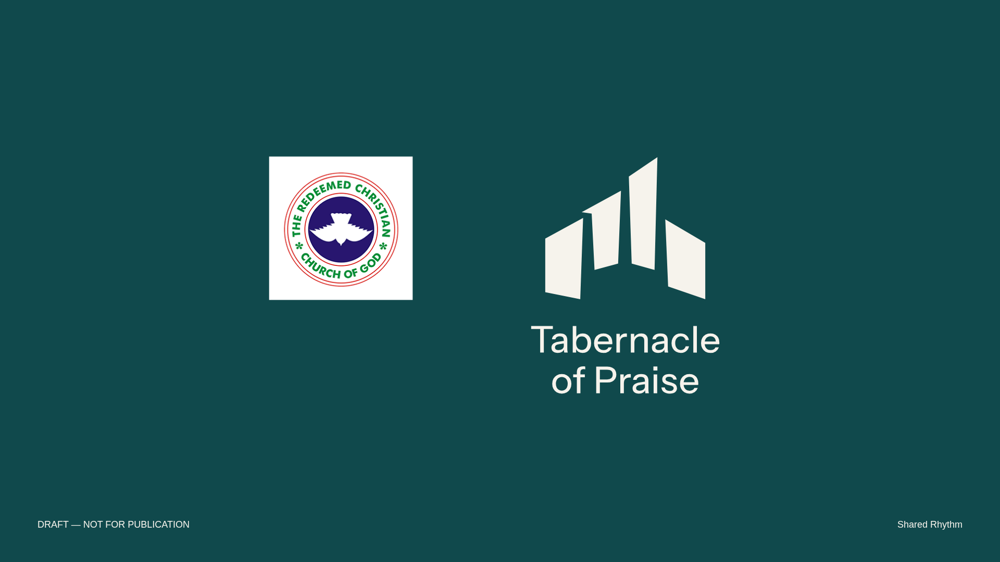

# RCCG paired motion graphics 14

**DRAFT — NOT FOR PUBLICATION.** Both developing parish logos now have actual motion graphics with the separate RCCG emblem included. The complete **Tabernacle of Praise** name remains below each symbol. No identity or motion system is finalized.



- **[Watch Shared Rhythm — widescreen MP4](exports/shared-rhythm-RCCG-motion-landscape-DRAFT.mp4)**
- **[Watch Open Praise — widescreen MP4](exports/open-praise-RCCG-motion-landscape-DRAFT.mp4)**
- **[Download both motion graphics and editable sources](exports/RCCG-TOP-MOTION-GRAPHICS-DRAFT.zip)**
- [Start here](exports/START-HERE.txt) · [Browser preview](preview.html)

## The movement

Shared Rhythm expresses the user's **“rising reaction to praises”** as **a rising response to praise**. Its four unequal planes rise in an overlapping cadence, then settle around their shared open space. The first two movements are coordinated to keep the shoulder interval open. This is a creative interpretation of shared worship, not an official mission or doctrinal statement. The outlines stay rigid; there is no morphing, added imagery or repeated equalizer pulsing.

Open Praise makes a quieter whole-symbol lift and settle while keeping its existing open counter and proposed T/P relationship. Neither option gains new symbols or altered lettering.

The RCCG emblem and parish name remain stationary throughout. Each video runs ten seconds at 30 fps, with a still closing hold from six to ten seconds. All four MP4s are silent, one-play compositions; they are not seamless loops. A draft footer sits outside the identity artwork.

## Videos and end frames

| Concept | Widescreen 1920×1080 | Square 1080×1080 |
|---|---|---|
| Shared Rhythm | [MP4](exports/shared-rhythm-RCCG-motion-landscape-DRAFT.mp4) · [PNG](exports/shared-rhythm-RCCG-motion-landscape-end-DRAFT.png) · [SVG](exports/shared-rhythm-RCCG-motion-landscape-end-DRAFT.svg) | [MP4](exports/shared-rhythm-RCCG-motion-square-DRAFT.mp4) · [PNG](exports/shared-rhythm-RCCG-motion-square-end-DRAFT.png) · [SVG](exports/shared-rhythm-RCCG-motion-square-end-DRAFT.svg) |
| Open Praise | [MP4](exports/open-praise-RCCG-motion-landscape-DRAFT.mp4) · [PNG](exports/open-praise-RCCG-motion-landscape-end-DRAFT.png) · [SVG](exports/open-praise-RCCG-motion-landscape-end-DRAFT.svg) | [MP4](exports/open-praise-RCCG-motion-square-DRAFT.mp4) · [PNG](exports/open-praise-RCCG-motion-square-end-DRAFT.png) · [SVG](exports/open-praise-RCCG-motion-square-end-DRAFT.svg) |

[Shared Rhythm GIF preview](previews/shared-rhythm-RCCG-motion-DRAFT.gif) · [Shared Rhythm storyboard](previews/shared-rhythm-RCCG-storyboard-DRAFT.png)

Download the portable [HTML preview](preview.html) to use its playback controls. The MP4s are ready to watch directly; no Google account or generation step is needed. These are controlled vector motion graphics, not AI-generated videos. Nothing has been uploaded to Google. The previous [Google handoff](../stacked-motion-13/README.md) remains available if needed, with the emblem kept outside generative inputs.

## Artwork and emblem integrity

The source is the dark stacked paired artwork from [study 13](../stacked-motion-13/pairings/README.md), preserving the refinement 11 parish paths and all 18 outlined letters of the full name. Only the parish symbol's vertical position changes. The working treatment is deep teal **#10494C**, ivory **#F6F3EC** and the emblem's original colors.

The full existing RCCG reference stays separate on a white panel, with no cropping, tracing, recoloring, stretching, generative treatment or effects. Its PNG bytes remain unchanged. It displays at 234×234 px in the widescreen video and 198×198 px in the square video, below its native 236×236 size. The [source record](../../assets/rccg-emblem/references/README.md) identifies it as an existing parish-source reference, not the unavailable original chat upload or an approved high-resolution production master. Final production-asset authorization and publication approval remain open.

## Editable sources and checks

- [Current brief](source/brief.md) · [Scene parameters](source/scene.json)
- [Renderer](source/build_motion.py) · [Rendering checks](exports/render-checks.json)
- [Download builder](source/build_package.py) · [Package manifest](exports/package-manifest.json)
- [Visual review](reviews/visual-review.md)

The SVGs retain editable parish vector paths and the separate embedded reference PNG. Scene parameters and timing are reusable for further revisions. Rebuild from the repository root using the existing Python, Pillow, NumPy/SciPy, Playwright/Chromium and ffmpeg environment:

```sh
python brand/explorations/rccg-motion-14/source/build_motion.py
python brand/explorations/rccg-motion-14/source/build_package.py
```

Exact end-pose and static-element checks apply before lossy H.264 encoding. Decoded videos are also checked for format and visual consistency; compression does not preserve pixel-for-pixel equality. File and frame checks establish rendering consistency, not audience recognition, print suitability or final approval. AGENTS.md and the church identity skill are unchanged.
