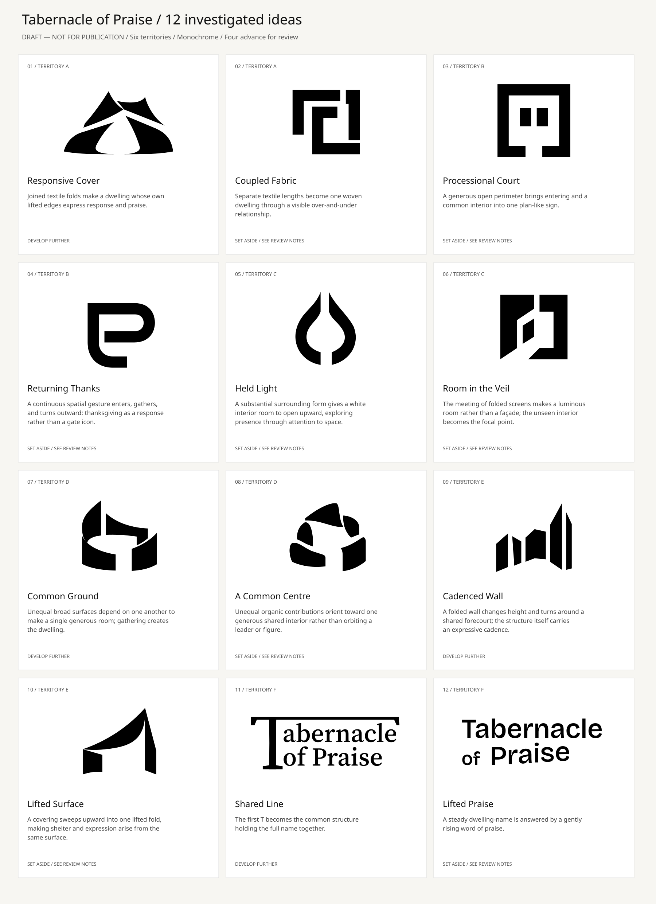

# Tabernacle of Praise — strategic identity study 04

**DRAFT — NOT FOR PUBLICATION. No concept, palette, typography, minimum size, or official lockup is approved.**

This is a fresh, research-led exploration of **dwelling and the response of praise**. Previous B/C/D studies remain historical; none is a mandatory finalist. There is no harp-led premise, color shortlist, or weekly flyer generator in this study.

## Open the review

- **[Interactive browser review — single offline HTML](exports/tabernacle-strategic-explorer.html)**. On GitHub, use **Download raw file**, then open the saved HTML in a browser. GitHub's code viewer does not run HTML applications.
- [Four developed directions — directly viewable image](exports/four-developed-concepts.png)
- [All 12 investigated ideas — directly viewable image](exports/initial-explorations.png)
- [Ten-page research/concept/application PDF](exports/strategic-review.pdf)
- [Complete editable study ZIP](exports/strategic-study-04-editable.zip)
- [Source browser app](index.html), [reusable study data](exports/study-data.json), [validation evidence](exports/validation-report.json)


## The identity strategy

A shared dwelling becomes expressive through its own opening, gathering, or uplift. The full name should be recognized before its explanation is known. The explanation should deepen a coherent form, rather than rescue an arbitrary one.

[The concise strategy](research/identity-strategy.md) connects six territories to evidence and identifies what each must avoid:

| Territory | Starting question | Initial ideas |
| --- | --- | --- |
| A — The Dwelling of Praise | Can the covering itself become an act of uplift? | 01 Responsive Cover; 02 Coupled Fabric |
| B — Enter His Courts | Can access and thanksgiving become one spatial response? | 03 Processional Court; 04 Returning Thanks |
| C — The Presence Within | Can the interior matter more than its container? | 05 Held Light; 06 Room in the Veil |
| D — One House, Many Voices | Can interdependent contributions make one shared dwelling? | 07 Common Ground; 08 A Common Centre |
| E — A Dwelling that Sings | Can structural cadence express praise without an instrument? | 09 Cadenced Wall; 10 Lifted Surface |
| F — The Living Wordmark | Can the full name carry the identity through letter relationships? | 11 Shared Line; 12 Lifted Praise |

The evidence includes all five requested passages: Exodus 25:8, Exodus 40:34–35, Psalm 100:4, Psalm 150, and Hebrews 9. Exodus 26–27 and Numbers 4 add the described construction and transport vocabulary.

- [Scriptural foundations and contextual limits](research/scriptural-foundations.md)
- [Architecture, history, and interpretation](research/architecture-and-symbolism.md)
- [Exact selected WEB text, URLs, dates, and response hashes](research/sources/scriptural-excerpts.json)
- [Retrieval notes](research/sources/scriptural-retrieval-notes.md) and [architectural retrieval log](research/architecture-retrieval-log.json)
- [Typography research, original font licenses, and measurements](research/typography-study.md)
- [The user's strategic brief](research/user-brief.md)

Public-domain WEB wording was verified using identified third-party structured mirrors. Publisher-hosted and several scholarly sites were inaccessible through the environment's proxy. The architectural synthesis therefore distinguishes the biblical literary description from unverified dating/archaeology and from modern artistic reconstruction. No precise ancient appearance or archaeological corroboration is claimed. Contemporary negative space/light metaphors do not depict God or establish parish doctrine. Psalm 100 is not treated as an Exodus plan; Hebrews 9's restricted ancient access and Christological argument remain part of the context.

## Why these four advance

| Review ID | Developed direction | Name-to-form relationship | Main unresolved risk |
| --- | --- | --- | --- |
| S1 / idea 01 | **Responsive Cover** | Joined textile folds hold a common interior; their lifted edges make the covering itself expressive. | Tent venue/sail associations; the opening may read as a robed figure or flame. Fine fold tips weaken tiny. |
| S2 / idea 07 | **Common Ground** | Unequal enclosing surfaces depend on each other to make one shared room: gathering creates the dwelling. | Cultural/architectural-institution reading; fine secondary crease closes small. |
| S3 / idea 09 | **Cadenced Wall** | Broad architectural folds surround an implied forecourt and carry an expressive cadence. | Skyline/performance-venue reading; articulation weakens at 16px. |
| S4 / idea 11 | **Shared Line** | The initial T becomes the common structure that holds the complete name. Typography carries the dwelling/praise relationship. | Roof/signboard emphasis; its provisional compact T is less distinctive than the full name. |

The four test different kinds of identifier: pictorial material, spatial enclosure, architectural sequence, and full-name typography. They are a **development shortlist for review**, not a selection of the church's identity. None is guaranteed to communicate every biblical association unaided.

The other eight remain visible with their reasons. 02 became an industrial/technology weave; 03 a rigid plan/maze; 04 a letter or wayfinding sign; 05 a flame/seed; 06 a portal/software icon; 08 a generic organic community mark; 10 overlapped the stronger covering idea; 12 risked event typography rather than enduring recognition. These are findings of exploration, not hidden discarded work.



## What is developed and editable

Each shortlisted direction has large monochrome artwork, construction parts and honest negative-space explanations, horizontal and stacked full-name arrangements, positive/reversed views, actual 64/32/24/16 CSS-pixel compact tests, 320/240px full-name tests, and the same limited paper/signage applications. Inspecting, keyboard navigation, local review notes, review selections, JSON feedback export, and editable SVG downloads work in the browser. Saving a review choice records no approval and sends nothing externally.

S4 is explicitly **wordmark-led**. Its full name is tested at practical widths. A separate derived T is shown at tiny avatar sizes; this does not imply that a complete wordmark works at 16px or that the T alone is sufficiently distinctive. S1/S3 still need separately reviewed micro-size solutions. The interface exposes these limitations instead of repairing them with color.

There are **21 reusable review SVG exports**: four primary artworks, eight full-name lockups, eight identity applications, and one provisional compact T. Each has draft metadata. Primary/wordmark/lockup artwork is outlined vector without live font dependencies. Application annotations retain editable text with explicit fallback fonts. [Browse SVGs and review outputs](exports/).

The illustrative façade is not a photograph or a claim about the actual church premises. Paper studies use `[CORRESPONDENCE TEXT]` and dummy text lines; no timetable, address, contacts, Scripture, speaker, mission, or other service facts are invented. The confirmed name, RCCG affiliation, and Istanbul/Türkiye context are used. The official RCCG emblem is a separate labeled reservation because authorized artwork is still absent; actual emblem balance/color compatibility cannot yet be verified.

## Typography and provenance

S1/S3 compare Source Serif 4 at weight 550 / optical size 24; S2 compares Instrument Sans at weight 550 / width 100. S4 combines licensed Source Serif 4 outlines with a purpose-drawn structural T. The name retains shaped kerning, and natural line-length differences are accepted rather than stretching lowercase. The selected font settings are comparison choices, not a permanent type system. Bricolage Grotesque remains in the initial type research and idea 12, with its license.

Original font files, OFLs, copyright, metadata, and checksums are retained. No modified font binary is redistributed. Local Noto UI fonts have a separate license notice. The eventual identity should have its own deliberate typography decision; these faces are not approved merely by appearing here.

Generated material studies informed selected construction directions; their images are retained under `source/` as ideation, with independently editable reconstructed paths. They are not authentic parish photographs, reference-logo traces, or evidence of legal exclusivity. The original inspiration image files were not present in the checkout; the recorded feedback's standards of integration, negative space, line precision, and restraint guided the work. Library SVGs were studied for construction principles only, not copied. The library is heavily oriented toward technology and supplied no church-category match; it does not establish originality or trademark clearance.

## Rebuilding

The delivered offline browser file needs only a browser. Development requires Python 3, fontTools, Pillow with shaping support, Node only for optional syntax checks, and Chromium/Playwright for verification/captures. Inkscape is used for board PNG rendering.

```sh
python3 brand/explorations/strategic-study-04/source/build_foundation_sketches.py
python3 brand/explorations/strategic-study-04/source/build_cover.py
python3 brand/explorations/strategic-study-04/source/build_collective_sketches.py
python3 brand/explorations/strategic-study-04/source/typography_sketches.py
python3 brand/explorations/strategic-study-04/source/build_shared_line.py
python3 brand/explorations/strategic-study-04/tools/build_study.py
python3 brand/explorations/strategic-study-04/tools/build_offline.py
```

Serve the study directory through an internal static server for `tools/verify_review.py` and `tools/capture_review.py`. Their default test endpoint is loopback port 8766. The managed browser blocks `file://`; the actual offline HTML is therefore executed in memory with all network requests blocked, including real SVG and feedback downloads. Double-click behavior in an unmanaged desktop browser was not tested here.

The [validation report](exports/validation-report.json) records **11 passed behavior/delivery checks**: six filters and all 12 studies; 16 exact source mappings; four developed concepts; reversal, modal focus and keyboard tabs; real pixel/name widths; 20 online and 20 offline SVG downloads; persisted notes and JSON feedback with no approval; 1440/768/390/320px layouts; zero external asset requests offline; and XML validity of all 24 exported SVGs, including boards. PDF content also passed footer-clearance checks on all ten pages and the rendered boards/PDF were visually inspected. These checks establish behavior and geometry transfer, not aesthetic or small-size recognition approval.

Meaningful prior v1 and developed iterations remain in `sketches/` and `concepts/`. The browser displays the developed prototypes for the four advancing ideas, alongside the eight set-aside initial studies. Source builders preserve the initial experiments rather than rewriting history. The initial hypotheses were rendered and reviewed before selection; developed marks were rendered/refined again and tested in reversal/at small sizes.

Automated SVG audit scores are construction heuristics, not aesthetic approval. The full-name wordmark naturally has more anchors than a symbol, while cloth/architectural slopes still contain optical geometry to refine. [Audit details](exports/svg-audit.txt) are retained. Screen evidence is not a print/material proof, a theological endorsement, a trademark search, or an approved minimum-size specification.

`AGENTS.md` and the RCCG identity skill are unchanged. No final selection, public brand publication, or weekly flyer generator is part of this study. The next step is your review of the four directions and their alternate readings.
