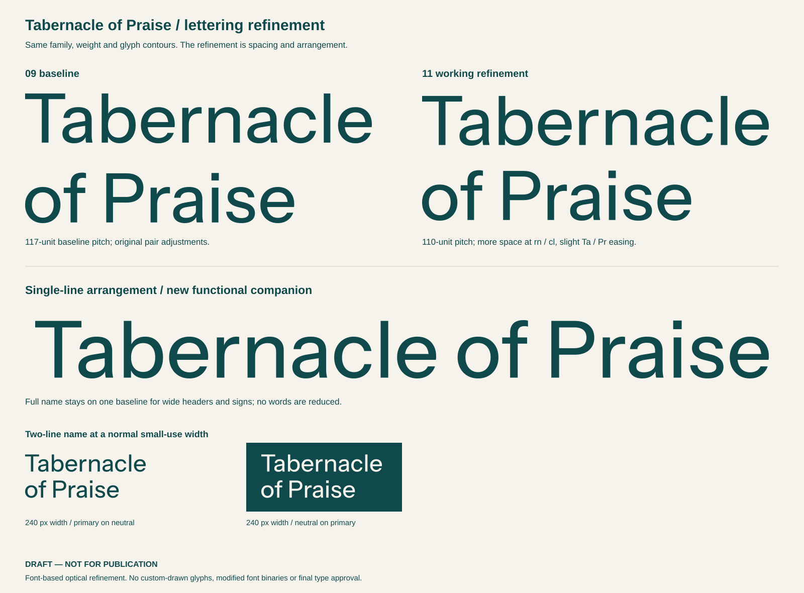

# Lettering refinement 11

**DRAFT — NOT FOR PUBLICATION.** Teal + sand is now the working color direction. These name arrangements support both Shared Rhythm and Open Praise; no final type system is approved.



- [Two lines, left aligned](wordmark.svg): `Tabernacle` / `of Praise`.
- [Two lines, independently centered](wordmark-centered.svg): for stacked combinations.
- [Single line](wordmark-single-line.svg): the complete name on one baseline for wide headers and signs.
- [Arrangement metadata and exact positions](metadata.json).

The font remains **Instrument Sans, width 100, weight 470**, with its original glyph outlines. The refinement brings the line pitch from 117 to 110 units at size 100, creating a more coherent name unit while leaving clear separation. Ta/Pr ease slightly, rn/cl open slightly, and neighboring pairs receive restrained optical adjustments. No letter is redrawn or distorted. The small word “of” retains the same size and weight as the rest of the name.

The baseline is preserved byte-for-byte in [versions/v0-review-09-two-line.svg](versions/v0-review-09-two-line.svg). A tighter 107-unit trial is [preserved separately](versions/v1-tight-leading-trial.svg) but not selected. The current 110-unit arrangement was visually inspected by its author and an independent editor, alongside the normal-width screen proof. Both judged its spacing readable and the single-line wordspaces natural. Assembled one-line symbol/name combinations still need testing at their actual header widths; the large master does not establish a minimum size.

The builder depends on the unmodified original font and [OFL license](../../identity-development-09/type-study/fonts/instrumentsans/OFL.txt) in the preceding development folder. The outlined SVGs display without any font dependency. Rebuild from the repository root:

```sh
python brand/explorations/teal-refinement-11/lettering/build.py
```

[Verification](verification.json) checks 18 outlined letter occurrences, no live type or raster artwork, and contours inside all three viewBoxes. These checks do not constitute final branding approval.
