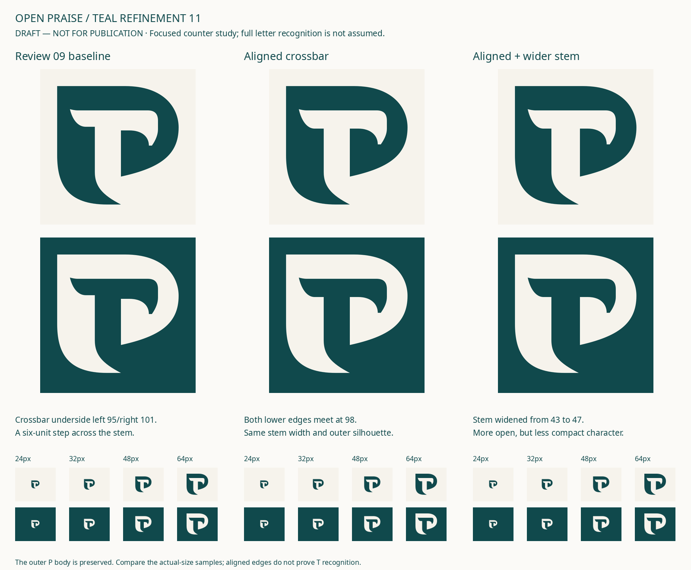

# Open Praise — teal refinement 11

**DRAFT — NOT FOR PUBLICATION.** Teal + sand is the user's chosen working color direction. The final logo, typography and production colors remain open.



## Current drawing

The proposed primary aligns the lower edges of the negative crossbar at **98**, replacing the previous **95 / 101** step. The negative stem remains 43 units wide. The outer P silhouette and flowing lower exit stay intact. The right counter terminal moves up two units to keep its curved transition compact.

This is a modest improvement to crossbar/stem cohesion. The negative T remains interpretive; no audience recognition test has been performed. Publisher, creative-studio and institutional associations remain possible.

The wider-stem trial is preserved but not chosen. Its opening becomes more dominant and its character less compact. Independent visual review preferred the middle aligned-crossbar version over that wider alternative.

## Editable sources

- [Primary black contour](primary.svg) — one actual closed path, transparent background.
- [Primary teal on ivory](primary-light.svg) · [Primary ivory on teal](primary-dark.svg).
- [Compact black contour](compact.svg) — provisional 16–20 px drawing.
- [Compact teal on ivory](compact-light.svg) · [Compact ivory on teal](compact-dark.svg).
- [Metadata, geometry audit and preserved versions](metadata.json).
- [Native compact comparison](renders/compact-comparison.png).

The compact candidate aligns the lower crossbar edges at 100 instead of the former 95 / 103, while keeping the 46-unit stem and shorter terminal. It is a small-use compensation, not a second logo. Use the primary in ordinary avatars and larger layouts. No physical-print minimum has been established.

## Inspection and limits

Viewed 512 px contours and actual native 24 / 32 / 48 / 64 px primary samples, teal on ivory and ivory on teal. Viewed native 16 / 20 px compact samples beside the previous compact. Both proof boards include explicit actual-size labels; their enlargements are diagnostic.

All 21 SVG files pass a single-closed-contour, no-live-type/no-raster/no-mask and exact-bound check. Every contour remains within the 256 × 256 canvas, with ink bounds 28 / 28 to 228 / 223. Structural checks do not establish semantic recognition, legal originality, fabrication suitability or approval.

The source builder is [source/build.py](source/build.py). From the repository root:

```sh
python brand/explorations/teal-refinement-11/open-praise/source/build.py
```

It uses Inkscape, Pillow and fontTools already available in this environment. Proof annotations use the existing repository Noto Sans font; this is not a wordmark selection or a modified font. The symbol has no font dependency. Neither earlier artwork nor permanent identity instructions are changed.
